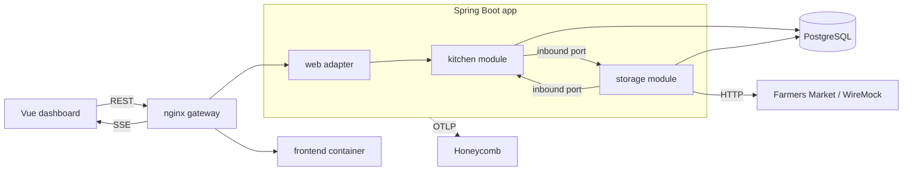
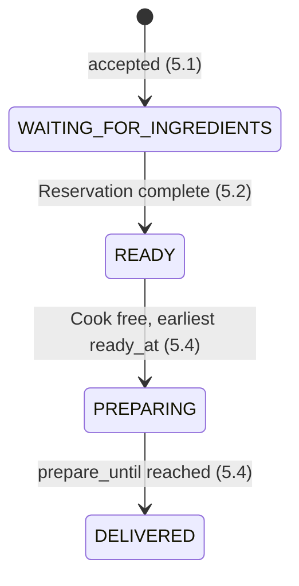

# RFC 0001 — food4good architecture

**Status:** Draft · **Date:** 2026-11-01 · **Requirements:** [PRD](../prd.md) · **Vocabulary:** [GLOSSARY.md](../../GLOSSARY.md) · **Decisions:** [ADR-0001](../adr/0001-single-writer-for-stock.md), [ADR-0002](../adr/0002-postgres-only-no-broker.md), [ADR-0003](../adr/0003-jdbcclient-and-flyway-over-jpa.md), [ADR-0004](../adr/0004-clean-architecture-without-spring-modulith.md)

## 1. Summary

One Spring Boot application with two clean-architecture modules (`kitchen` and `storage`) and a `shared` module over a single PostgreSQL database. PostgreSQL is both the system of record and the work queue. Taking Orders is synchronous and cheap. Everything after that (reserving, buying, cooking) is done by background workers that claim rows with `FOR UPDATE SKIP LOCKED`. Stock is changed by exactly one writer. A Vue dashboard receives live updates over SSE. Traces go to Honeycomb over OTLP.

## 2. Stack

| Concern | Choice |
|---|---|
| Language / runtime | Java 25, virtual threads on |
| Framework | Spring Boot 4.x |
| Build | Gradle, Kotlin DSL |
| Database | PostgreSQL 17 |
| Persistence | Spring `JdbcClient`, hand-written SQL; Flyway migrations |
| Farmers Market client | `@HttpExchange` interface on `RestClient`, JDK `HttpClient` underneath |
| Live updates | Server-Sent Events (`SseEmitter`) |
| Observability | OpenTelemetry via Spring Boot's OTel support → OTLP → Honeycomb |
| Frontend | Node 26 LTS, npm, Vue 3, Vite, TypeScript, PrimeVue 4.5.5 (styled, Aura), Pinia Colada; oxlint + oxfmt |
| Market stub | WireMock with a response template |
| Local runtime | Docker Compose, with an nginx gateway as the entry point |
| Tests | JUnit 5, Testcontainers (PostgreSQL, WireMock), ArchUnit |
| Load test | k6 |

## 3. Architecture overview



### 3.1 Modules and layering

Every module has the same layout ([ADR-0004](../adr/0004-clean-architecture-without-spring-modulith.md)):

```
com.food4good.<module>
├── domain                   plain Java, no Spring
│   ├── model                entities, value objects, invariants
│   ├── ports
│   │   ├── in               use cases the module offers (ListRecipesUseCase)
│   │   └── out              what the module needs (RecipeRepositoryPort)
│   └── service              use case implementations (ListRecipesService)
└── infrastructure
    ├── adapters
    │   ├── in/rest          controllers and DTOs
    │   ├── in/worker        background workers
    │   └── out/persistence  JDBC repositories (out/market: Farmers Market client)
    └── configuration        bean wiring, properties
```

`com.food4good.shared` holds what every module uses, such as `Ingredient`, in the same layout.

**Cross-module rule.** Modules call each other only through the other module's `domain/ports/in` or through `shared`. An ArchUnit test enforces this, and that `domain` stays free of Spring and of `infrastructure`.

Cross-module calls are **synchronous and run inside the caller's transaction**. All modules share one database, so calling another module's port inside our transaction is atomic and needs no outbox. Asynchrony exists only where real waiting happens: the stock single writer, market calls and cooking time. Each has its own durable queue.

| Inbound port | Offered by | Used by | Effect |
|---|---|---|---|
| `IngredientRequests.request(orderId, recipe)` | storage | kitchen | Records the Reservation lines and enqueues a `RESERVE` storage command |
| `IngredientRequests.consume(orderId)` | storage | kitchen | Enqueues a `CONSUME` storage command |
| `OrderReadiness.markReady(orderId)` | kitchen | storage | Order → **ready** (called when a Reservation completes) |

## 4. Data model

PostgreSQL enforces the stock invariants (PRD NFR-3), not just the application code.

```sql
CREATE TABLE recipe (
  id                       uuid PRIMARY KEY DEFAULT gen_random_uuid(),
  name                     text NOT NULL UNIQUE CHECK (btrim(name) <> ''),
  preparation_time_seconds int  NOT NULL CHECK (preparation_time_seconds > 0)
);

CREATE TABLE recipe_ingredient (
  recipe_id  uuid NOT NULL REFERENCES recipe (id) ON DELETE CASCADE,
  ingredient text NOT NULL CHECK (ingredient IN ('tomato', 'lemon', '...')),
  quantity   int  NOT NULL CHECK (quantity > 0),
  PRIMARY KEY (recipe_id, ingredient)
);

CREATE TABLE ingredient_stock (
  ingredient  text PRIMARY KEY,
  on_hand     int  NOT NULL CHECK (on_hand  >= 0),
  reserved    int  NOT NULL CHECK (reserved >= 0),
  CHECK (reserved <= on_hand)
);

CREATE TABLE orders (
  id             uuid PRIMARY KEY,
  recipe_id      uuid        NOT NULL REFERENCES recipe(id),
  recipe_name    text        NOT NULL,          -- as accepted; a later edit does not change it
  prep_ms        int         NOT NULL,          -- scaled preparation time, frozen at acceptance
  status         text        NOT NULL CHECK (status IN ('WAITING_FOR_INGREDIENTS','READY','PREPARING','DELIVERED')),
  accepted_at    timestamptz NOT NULL,
  ready_at       timestamptz,
  preparing_at   timestamptz,
  prepare_until  timestamptz,
  delivered_at   timestamptz,
  traceparent    text
);
CREATE INDEX orders_ready_idx     ON orders (ready_at)      WHERE status = 'READY';
CREATE INDEX orders_preparing_idx ON orders (prepare_until) WHERE status = 'PREPARING';
CREATE INDEX orders_open_idx      ON orders (status)        WHERE status <> 'DELIVERED';
CREATE INDEX orders_history_idx   ON orders (accepted_at DESC, id);

CREATE TABLE reservation_line (
  order_id    uuid NOT NULL REFERENCES orders(id),
  ingredient  text NOT NULL REFERENCES ingredient_stock(ingredient),
  needed      int  NOT NULL CHECK (needed > 0),
  reserved    int  NOT NULL DEFAULT 0 CHECK (reserved >= 0 AND reserved <= needed),
  consumed    boolean NOT NULL DEFAULT false,
  PRIMARY KEY (order_id, ingredient)
);

CREATE TABLE purchase (
  id             bigserial PRIMARY KEY,
  ingredient     text   NOT NULL,
  quantity       int    NOT NULL CHECK (quantity > 0),
  market_job_id  bigint NOT NULL,
  attempt        int    NOT NULL,
  purchased_at   timestamptz NOT NULL,
  UNIQUE (market_job_id, attempt)               -- idempotency
);

CREATE TABLE storage_command (
  id           bigserial PRIMARY KEY,           -- processing order
  type         text  NOT NULL CHECK (type IN ('RESERVE','ADD_PURCHASE','CONSUME')),
  payload      jsonb NOT NULL,
  dedupe_key   text  NOT NULL UNIQUE,           -- e.g. RESERVE:<orderId>
  status       text  NOT NULL DEFAULT 'PENDING' CHECK (status IN ('PENDING','DONE','FAILED')),
  attempts     int   NOT NULL DEFAULT 0,
  last_error   text,
  created_at   timestamptz NOT NULL DEFAULT now(),
  traceparent  text
);
CREATE INDEX storage_command_pending_idx ON storage_command (id) WHERE status = 'PENDING';

CREATE TABLE market_job (
  id               bigserial PRIMARY KEY,
  order_id         uuid NOT NULL REFERENCES orders(id),
  ingredient       text NOT NULL,
  remaining        int  NOT NULL CHECK (remaining >= 0),
  status           text NOT NULL DEFAULT 'PENDING' CHECK (status IN ('PENDING','IN_FLIGHT','DONE','FAILED')),
  attempt          int  NOT NULL DEFAULT 0,       -- total calls made
  zero_streak      int  NOT NULL DEFAULT 0,       -- consecutive zero sales; drives backoff
  error_attempts   int  NOT NULL DEFAULT 0,       -- defects, not zero sales
  next_attempt_at  timestamptz NOT NULL DEFAULT now(),
  lease_until      timestamptz,
  traceparent      text,
  UNIQUE (order_id, ingredient)
);
CREATE INDEX market_job_due_idx ON market_job (next_attempt_at) WHERE status = 'PENDING';
```

Recipes live in their own tables, and the starting six are inserted once by a migration (PRD §6). Editing a Recipe never touches accepted Orders: `orders` keeps the Recipe's id and name, `prep_ms` freezes the scaled preparation time, and `reservation_line` holds the quantities (PRD FR-8.3). Cooks and the Maximum wait are configuration (PRD §7).

## 5. Flows

### 5.1 Place Orders (synchronous, `POST /api/orders`)

```mermaid
sequenceDiagram
  participant UI
  participant API as kitchen: PlaceOrders
  participant DB
  UI->>API: POST /api/orders {quantity}
  API->>DB: BEGIN; pg_advisory_xact_lock(ADMISSION)
  API->>DB: SELECT backlog work (open orders)
  loop until quantity or capacity reached
    API->>API: draw Recipe uniformly; fits? (backlog + prep ≤ maxWait × cooks)
  end
  API->>DB: INSERT orders, reservation_line, storage_command(RESERVE) — batched
  API->>DB: COMMIT (+ NOTIFY storage)
  API-->>UI: {requested, accepted, orderIds, estimatedWait}
```

**Admission is serialized** by a transaction-scoped advisory lock. Two concurrent requests must not both see the same free capacity. The backlog work is

```
Σ prep_ms                          over WAITING_FOR_INGREDIENTS and READY
+ Σ greatest(prepare_until − now, 0) over PREPARING
```

which the `orders_open_idx` partial index serves. Capacity is `maxWait × cooks`, and the estimated wait is `backlogWork ÷ cooks`. The transaction holds the lock only for one aggregate query, one batched insert and the commit, a few milliseconds in total. See §10 for the risk this creates under NFR-1.

### 5.2 Reserve (storage single writer)

The **storage worker** is one virtual thread holding a session-level `pg_try_advisory_lock(STORAGE_WRITER)`. A second instance's worker fails to take the lock and stays idle (ADR-0001). The worker loop:

1. Wake on `NOTIFY storage` or after a 1 s fallback poll.
2. `SELECT … FROM storage_command WHERE status='PENDING' ORDER BY id LIMIT 50`. There is no `SKIP LOCKED`, because there is only one writer.
3. Apply each command in **its own transaction** together with `status='DONE'`. A defect increments `attempts`. At 5 the command becomes `FAILED` and is logged, and the worker moves on (NFR-6).

| Command | Effect (one transaction) |
|---|---|
| `RESERVE(orderId)` | For each line: `take = min(needed, on_hand − reserved)`; `reserved += take` on stock and line. For every line still short, insert `market_job(remaining = needed − reserved)`. If nothing is short, call `OrderReadiness.markReady`. |
| `ADD_PURCHASE(jobId, attempt, qty)` | Insert `purchase` (the unique key makes it idempotent). `on_hand += qty`. `give = min(qty, line.needed − line.reserved)`; `reserved += give` on stock and line. Surplus `qty − give` stays available. If every line is full, call `markReady`. |
| `CONSUME(orderId)` | For each line not yet consumed: `on_hand −= reserved`, `stock.reserved −= reserved`, `consumed = true`. |

Each command is a few row updates, so even a 1,000-Order burst (1,000 `RESERVE`s) drains in seconds.

### 5.3 Buy from the Farmers Market (buyer workers)

```mermaid
sequenceDiagram
  participant B as storage: buyer worker
  participant DB
  participant FM as Farmers Market
  B->>DB: claim due jobs: UPDATE … SET status='IN_FLIGHT', lease_until=now()+lease<br/>WHERE id IN (SELECT … WHERE status='PENDING' AND next_attempt_at<=now()<br/>ORDER BY next_attempt_at FOR UPDATE SKIP LOCKED LIMIT free_slots)
  B->>FM: GET /buy?ingredient=cheese (1 s connect / 2 s read)
  FM-->>B: {quantitySold: n}  (timeout/5xx ⇒ n = 0)
  alt n > 0
    B->>DB: INSERT storage_command(ADD_PURCHASE, jobId, attempt, n); remaining −= n;<br/>zero_streak = 0; DONE if remaining = 0 else PENDING, next_attempt_at = now()
  else n = 0
    B->>DB: zero_streak += 1; PENDING; next_attempt_at = now() + backoff(zero_streak)
  end
```

- **Concurrency.** A semaphore of `MAX_CONCURRENT_MARKET_CALLS` (20) limits in-flight calls. Each call runs on its own virtual thread.
- **No connection or lock is held during the HTTP call.** The job is claimed and committed first, then the call is made, then the result is written in a second transaction.
- **Crash recovery.** A job left `IN_FLIGHT` past `lease_until` is reclaimed by the next claim query. The sale from the lost call may have happened, which is the accepted gap in the PRD (§3).
- **Client.** `FarmersMarketPort.buy(ingredient)` is an outbound port of Food Storage. It makes one HTTP call and returns the units sold, 0 on any failure.
- **Backoff.** `min(250 ms × 2^(zero_streak−1), 5 s)` with ±20 % jitter. A sale resets it.
- One call is one attempt, because the market accepts no quantity.

### 5.4 Cook (kitchen scheduler)

One kitchen scheduler loop, holding `pg_try_advisory_lock(KITCHEN)`, wakes on `NOTIFY kitchen` (when an Order becomes ready), on the earliest `prepare_until`, or after a 1 s fallback poll. Each tick has two steps:

1. **Deliver.** `UPDATE orders SET status='DELIVERED', delivered_at=now() WHERE status='PREPARING' AND prepare_until <= now()`.
2. **Start.** `free = cooks − count(PREPARING)`. Claim up to `free` READY Orders `ORDER BY ready_at FOR UPDATE SKIP LOCKED`. Set them `PREPARING`, `preparing_at=now()`, `prepare_until=now()+prep_ms`, and call `IngredientRequests.consume(orderId)` in the same transaction.

No thread sleeps through a preparation and no transaction stays open. Because `prepare_until` is stored, a restart resumes cooking exactly where it stopped (NFR-2).

`CONSUME` runs asynchronously, so for a moment an Order is **preparing** while its units still show as reserved. The invariants still hold, and on-hand stock drops by the time the next storage command is processed.

### 5.5 Order lifecycle



Every transition is a conditional `UPDATE … WHERE id = ? AND status = <expected>`, so a replayed command is a no-op.

## 6. API

All endpoints are under `/api`. JSON uses camelCase. The OpenAPI document is generated from code and committed under `docs/rfc/openapi.yaml`.

| Method & path | Purpose |
|---|---|
| `POST /orders` `{quantity}` | → `200 {requested, accepted, orderIds[], estimatedWaitSeconds}`. `400` if quantity < 1 or > 10,000. Accepting 0 is still `200`. |
| `GET /orders?status=&cursor=&limit=` | Order history, newest first, keyset-paginated on `(accepted_at, id)` |
| `GET /kitchen` | `{cooks, busyCooks, maxWaitSeconds, backlogSeconds, estimatedCapacity}` |
| `GET /storage` | `[{ingredient, onHand, reserved, available}]` |
| `GET /purchases?cursor=&limit=` | Purchase history, newest first |
| `GET /recipes` | Recipes with id, Ingredients, quantities and preparation times, ordered by name |
| `POST /recipes` | Creates a Recipe: `201` with its location. `400` if invalid, `409` if the name is taken. |
| `PUT /recipes/{id}` | Replaces a Recipe's name, Ingredients and preparation time. `400`, `404`, `409`. |
| `GET /events` | SSE stream (§7) |

Errors are RFC 9457 problem details, with the message for the Manager in `detail`.

`estimatedCapacity` = ⌊(maxWait × cooks − backlogWork) ÷ avgPrep⌋, never below 0 (PRD FR-2).

## 7. Live updates (SSE)

Workers and use cases publish in-process domain events. A `@TransactionalEventListener(AFTER_COMMIT)` forwards them to an `SseHub`, so a client never sees a change that later rolls back.

To avoid flooding the browser during a burst, the hub **coalesces**: every 250 ms it sends one batch per event type with only the latest state per key.

| SSE event | Payload |
|---|---|
| `orders` | `[{id, recipe, status, ...timestamps}]` changed since the last batch |
| `storage` | full stock snapshot (10 rows) |
| `purchases` | Purchases created |
| `kitchen` | `/kitchen` snapshot |

Each batch carries a monotonic `id`. A client that reconnects refetches all queries instead of trying to replay, which is simpler and good enough with one instance (PRD FR-7.2).

**With more than one instance**, a client is connected to one instance and would miss events committed on another. The fix is to publish events through `NOTIFY f4g_events` and have every instance `LISTEN` and fan out. This is deferred until the load test calls for more instances.

## 8. Frontend

- **Single dashboard** with PrimeVue panels matching PRD FR-7: `DataTable` with virtual scrolling for histories, `Tag` for statuses, `InputNumber` plus `Button` for placing Orders, and `Toast` for request results.
- **Server state** lives in Pinia Colada: one query per endpoint, with keys `['orders', filters]`, `['storage']`, `['purchases']`, `['kitchen']` and `['recipes']`. `PlaceOrders` is a mutation.
- **`useLiveEvents()`** opens a single `EventSource`, patches the cache with `queryCache.setQueryData` per batch, and invalidates every query on `open` after a reconnect.
- **Tooling:** oxlint and oxfmt, and `vue-tsc` for type checking.
- **PrimeVue stays on 4.5.5 with `@primeuix/themes` 2.0.3, pinned exactly.** These are the last MIT releases. PrimeVue 5 and themes 3 use the commercial PrimeUI license and need a license key, so do not upgrade without a licensing decision.

## 9. Observability

- **Setup.** The OTel SDK is configured by Spring Boot, with Micrometer Observation bridged to OTel. OTLP/HTTP goes to `api.honeycomb.io` with the `x-honeycomb-team` header. When `HONEYCOMB_API_KEY` is unset, the exporters are disabled and logs stay local.
- **Spans.**
  - One span per use case (`PlaceOrders`, `Reserve`, `AddPurchase`, `Consume`, `StartCooking`, `Deliver`) and one per market call. The market-call span comes from `RestClient` observation.
  - Attributes: `order.id`, `recipe`, `ingredient`, `market.quantity_sold`, `market.attempt` and `admission.accepted`.
- **Across async hops.** Every queued row (`orders`, `storage_command`, `market_job`) stores the creating span's W3C `traceparent`. Workers start a new root span with a **span link** to it, and copy `order.id`, so one Order's journey can be queried in Honeycomb without minutes-long open traces.
- **Metrics.**
  - Gauges: `kitchen.backlog.seconds`, `kitchen.cooks.busy`, `storage.commands.pending`, `market.jobs.pending`.
  - Counters: `market.calls{result=sold|zero|error}`, `jobs.failed{queue}`.
- **Logs** are structured JSON with trace and span IDs.

## 10. Risks and known gaps

| Risk | Mitigation |
|---|---|
| **Admission lock vs NFR-1.** 100 simultaneous requests queue on one advisory lock. At ~3 ms each, the last waits ~300 ms. | Keep the critical section to one aggregate query and one multi-row insert. Measure with k6. If p99 fails, keep a single `kitchen_capacity` row updated with a conditional `UPDATE … WHERE work + :n <= capacity RETURNING`, which shortens the lock to one row update. A second instance does not help here. |
| Market non-idempotency: a lost response after a sale. | Accepted gap (PRD §3). Units sold by a call whose response was lost never reach stock. |
| Waiting Reservations do not benefit from another Order's surplus: an Order short of cheese keeps buying even after surplus cheese lands in stock. | Matches the agreed rule. Possible v2: `ADD_PURCHASE` surplus tops up waiting lines in FIFO order. See §12. |
| Single storage writer is a throughput ceiling. | Each command takes microseconds to milliseconds. Fallback is conditional atomic updates (ADR-0001). |
| SSE with multiple instances. | `LISTEN/NOTIFY` fan-out (§7), deferred. |

## 11. Testing and verification

**One seam: the public HTTP API (REST + SSE).** Behaviour tests boot the whole app against Testcontainers PostgreSQL and a WireMock Farmers Market, act only through `/api`, and assert only on what the API returns. There are no in-memory fakes or test-only hooks in production code. Configuration provides the control instead:

| Control | How |
|---|---|
| Random Recipe choice | Edit all the Recipes through `PUT /api/recipes/{id}` to have the same known Ingredients, so the draw does not matter |
| Time | Tiny `PREP_TIME_SCALE`, then await the status the API reports |
| Farmers Market | WireMock stubs per test: zero sales, sequenced sales, delays past the read timeout, 5xx |
| Restart recovery | Stop and restart the app against the same database container; every accepted Order still reaches **delivered** |
| Stock invariants | `GET /api/storage` after each step: on hand ≥ 0, reserved ≥ 0, reserved ≤ on hand |
| Concurrency | N concurrent `POST /api/orders`, then check invariants and that the count of distinct Orders equals the sum of `accepted` |

Two checks sit outside that seam:

| Check | What |
|---|---|
| Architecture | ArchUnit: `domain` free of Spring and `infrastructure`; modules reach each other only through `domain/ports/in` or `shared` |
| Load (k6) | 1,000 Orders = 100 concurrent × 10, with `PREP_TIME_SCALE=0.01` and enough capacity. Pass when p99 < 200 ms, every Order exists exactly once, stock invariants hold, and all are **delivered** before a timeout. |

## 12. Open questions

1. **Surplus top-up for waiting Reservations** (§10). It is out of scope for v1 unless the demo shows wasteful buying.

## 13. Repository layout

```
backend/            Gradle project (modules = Java packages, verified by ArchUnit)
frontend/           Vue + Vite app
infra/
  docker-compose.yml   postgres, wiremock, backend, frontend, gateway
  nginx.conf           gateway routes: /api/ to the backend, everything else to the frontend
  wiremock/mappings/   buy.json — quantitySold {{randomInt lower=0 upper=10}}, uniform delay 0–3 s
load-tests/         k6 scripts
docs/  prd.md · rfc/ · adr/
GLOSSARY.md
```
